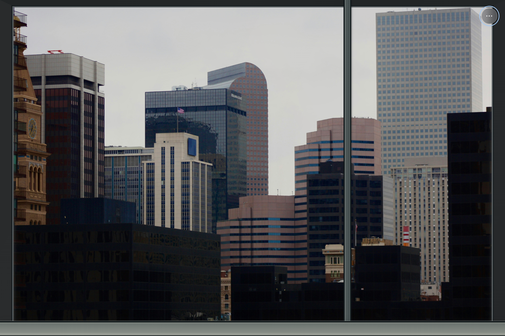

# 数字窗户 · Digital Window 1.3.0

将屏幕变成一扇随远方日光变化的窗。Windows 原生无边框全屏覆盖显示器及任务栏，主画面只保留右上角三个点。景观、天文计算和偏好在本机运行，内置资源可离线使用。

1.3.0 新增丹佛写字楼窗景，将全部八处摄影景观换成高分辨率实拍，并取消最终画布 1600 像素长边限制。摄影 WebGL 和 Canvas 回退按屏幕物理像素输出；移除重复滤镜、照片漂移与错位的人工阴影。第九处「云山镜湖」仍是独立的程序景观。



丹佛背景摄影：[Shade / Unsplash](https://unsplash.com/photos/a-city-skyline-with-tall-buildings-GPjse2kaUKA)，保留 [Unsplash License](https://unsplash.com/license)；窗框与调光由应用呈现。截图是当前显示器的原生屏摄，不是 4K 显示器截图；4K 帧缓冲另由集成测试验证。

## 使用

双击 `启动数字窗户.cmd`，或运行 `release/数字窗户-win32-x64/数字窗户.exe`。打包版无需 Node.js；移动和分享时保留整个文件夹。

- 点击 **··· → 窗外景观** 选择「丹佛，云端办公」或其他景观。
- 「时区与日光」默认跟随景观所在地，可改成伦敦等城市或自定义 IANA 时区与经纬度。支持夏令时、季节、极昼和极夜。
- 拖动一天预览滑块观察连续调光；五个时段按钮只是快捷入口。开启实时日光恢复当前时刻。
- 「窗外朝向」决定日月方向与补光，每处景观分别保存；摄影朝向是可调估计，并非标定测量。
- 「显示」可调亮度、极简装饰窗框和视频/程序景观动态。关闭动态仍每 250 毫秒更新日月光线；实拍采用固定机位，不叠加不对应的雾、鸟或漂移动效。
- 支持导入 JPG、PNG、WebP、AVIF、MP4 和 WebM，最大 250 MB。视频静音循环，导入文件与设置在本机保存并在重启后恢复。

| 快捷键 | 操作 |
| --- | --- |
| F11 | 切换原生全屏 |
| Esc | 退出全屏，设置打开时也有效 |
| L / T | 打开景观 / 日光设置 |
| Alt + F4 | 退出应用 |

窗口模式可拖动顶部空白区域。启动采用鼠标所在显示器的完整 `display.bounds`，不跨屏拉伸，不修改任务栏设置。静置隐藏鼠标并调淡三个点，显示期间阻止显示器自动休眠，退出后恢复。

## 景观与真实画质

| 景观 | 实拍与原生尺寸 |
| --- | --- |
| 曼哈顿，窗外 | Davidwbarratt；美洲大道32号21层真实窗内视角；4048×3036 |
| 丹佛，云端办公 | Shade；丹佛市中心楼群；4272×2848；软件另绘写字楼窗框、窗台 |
| 旧城，慢时光 | Tiia Monto；布拉格老城广场；10919×3659 |
| 京都，巷深处 | Basile Morin；清晨八坂通与八坂塔；5550×3700 |
| 富士，映湖间 | Алексей Чикишев；山中湖东岸平野之滨；6660×2055 |
| 山湖之间 | Adam Bishop；梦莲湖；7759×3512 |
| 海风来信 | Ввласенко；马尔代夫艾瑞雅度岛；5887×3929 |
| 林间有光 | Peter Heeling；晨雾森林；4550×2879；地点未可靠记录，北京仅作日光参考 |
| 云山镜湖 | 程序绘制天空、山峦、湖面、云与星空 |

照片保存下载所得字节，没有 AI 生成、扩图或超分放大。除富士山外，七张照片的 16:9 有效裁切达到原生 UHD；富士山约为 3653×2055，不能称全部素材都是原生 4K。运行时等比铺满屏幕，不同屏幕比例会裁去边缘。

丹佛是**真实城市背景 + 单独绘制的室内窗框**。来源不能确认原片拍摄于办公室内，不能把完整合成画面冒称未经修改的室内实拍。来源与许可见 [ASSET_CREDITS.md](ASSET_CREDITS.md)、[七张 Commons 原图清单](assets/landscapes/photos/sources.json) 和 [丹佛来源](assets/landscapes/photos/denver-source.json)。

## 连续光线与边界

应用每 **250 毫秒**读取 UTC 时刻，按经纬度计算日月高度、方位与月相，结合镜头朝向连续补光。计算独立于时段按钮和照片数量，关闭动态仍继续。太阳采用 [USNO 近似公式](https://aa.usno.navy.mil/faq/sun_approx)，日出日落使用 [NOAA −0.833° 地平线标准](https://gml.noaa.gov/grad/solcalc/calcdetails.html)；月球采用 SunCalc / Meeus 60+60 项周期系列、观测点视差及近似折射。

**摄影模式优先保留原片的结构、纹理和自然光照。** 曝光、色温与温和定向日月补光持续变化，不在新照片上套用旧 AI 图的几何多边形，也不添加第二个太阳或月亮。它并非真实固定机位昼夜延时摄影；原片的阴影、路人、天空和灯光不能全部重算。夜间是连续环境调光，不能当作当地实拍夜景。

WebGL 按 `CSS 尺寸 × devicePixelRatio` 输出，并结合 GPU 纹理、视口及缓冲区上限约束。原图仅在超过 GPU 纹理限制时等比缩小上传。摄影 Canvas 回退也保持原生输出，通过原生绘图与合成避免逐像素读取 4K 图像的 CPU 开销；两种路径的补光存在细微外观差异。「云山镜湖」继续使用实际日月位置与月相。应用不读取实时天气或摄像头。

真实改变建筑投影需要同机位多时刻摄影，或经过材质和照明分离的三维重建。锐化和标准 3D Gaussian Splatting 不能自动提供任意重光照；调研及原始论文见 [ASSET_RESEARCH.md](ASSET_RESEARCH.md)。

## 开发、验证与打包

要求 Windows 10 或以上、Node.js 22.12 或以上。依赖安装需要联网，运行时不请求外部图片或 API。

```powershell
npm ci
npm start
npm run dev
npm test
npm run smoke
npm run package
node scripts/verify-software.cjs --target all --report reports/software-tests.json
```

统一检查涵盖源码与打包资源一致性、52项单元测试、九处景观、时区/预览、GPU/Canvas及上下文恢复、媒体导入和持久化、原生全屏与五个退出/生命周期场景。光照集成测试通过实际 Chromium 高 DPI 仿真检查八张照片的 **3840×2160 输出**、源尺寸、重复滤镜和错误几何，并保存 GPU 截图至 `.test-results/*-quality-*.png`。结果以 [测试报告](reports/software-tests.json) 为准；可用 `--target source` 或 `--target packaged` 限定对象。

GitHub Actions 在 Windows 安装依赖、执行单元测试、打包并上传产物。`scripts/fetch-photo-upgrades.py` 可按清单重新下载七张 Commons 原图；丹佛原图单独记录。SHA-256 用于核验原图字节。

| 文件 | 职责 |
| --- | --- |
| `electron/main.cjs` / `preload.cjs` | 原生窗口、全屏、退出、受限IPC与集成测试 |
| `src/renderer.js` / `scene-view.js` | 设置、媒体、景观解码和过渡 |
| `src/scenes.js` | 景观、原生尺寸和城市配置 |
| `src/relighting.js` | 原生像素 WebGL 与 Canvas 连续补光 |
| `src/office-window.css` | 丹佛的写字楼窗框前景 |
| `src/celestial.js` / `lighting.js` | 日月星历、镜头方向和光照参数 |
| `src/atmosphere.js` | 程序景观；实拍模式保持透明 |
| `assets/landscapes/photos` | 离线实拍及作者、许可和来源 |

渲染器开启 context isolation 与 sandbox，关闭 Node 集成，限制导航和外部网络。设置和导入媒体留在本机，不发送遥测。

## 许可

原创代码采用 MIT，SunCalc 改编部分 BSD-2-Clause，见 [THIRD_PARTY_NOTICES.md](THIRD_PARTY_NOTICES.md)。摄影及其改编保留对应 CC 或 Unsplash 许可，**不按代码 MIT 重新授权**。作者、许可和改动说明随软件分发。旧 AI 图已移出运行资源，历史生成记录不代表当前画面。
